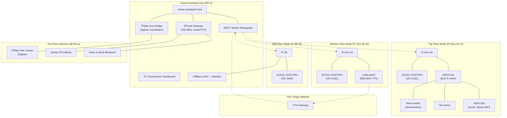

# Architecture

## Overview

```
┌─────────────────────────────────────────────────────────────────────────────┐
│                              HOME ASSISTANT HUB                               │
│                         (Raspberry Pi 5 — Hub)                                │
│  ┌──────────────┐  ┌──────────────┐  ┌──────────────┐  ┌──────────────┐     │
│  │  Home Asst   │  │    MQTT      │  │   Hue Bridge │  │  RFLink      │     │
│  │   Core       │◄─┤   Broker     │  │   (LAN API)  │  │  (serial/TCP)│     │
│  └──────────────┘  └──────┬───────┘  └──────┬───────┘  └──────┬───────┘     │
│                           │                   │                 │             │
│         ┌─────────────────┼───────────────────┼─────────────────┘             │
│         │                 │                   │                               │
│  ┌──────▼──────┐   ┌───────▼────────┐  ┌──────▼────────┐                      │
│  │   Pi#1      │   │   Floor Nodes  │  │   Bridges     │                      │
│  │  (dashboard)│   │  (MQTT over    │  │  (LAN/433MHz) │                      │
│  │  7" touch   │   │   Wi-Fi)       │  │               │                      │
│  └─────────────┘   └────────────────┘  └───────────────┘                      │
└─────────────────────────────────────────────────────────────────────────────┘
                ▲                   ▲                   ▲
                │ Wi-Fi             │ Wi-Fi             │ 433 MHz / LAN
                ▼                   ▼                   ▼
        ┌───────────────┐   ┌───────────────┐   ┌───────────────┐
        │  TOP FLOOR    │   │  MID FLOOR    │   │ BOTTOM FLOOR  │
        │  (Pi Zero W#1)│   │  (Pi 3B #2)   │   │ (Pi Zero W#2) │
        │               │   │               │   │               │
        │ SCD41 (CO₂/T/ │   │ SCD41 (CO₂/T/ │   │ SCD41 (CO₂/T/ │
        │  RH)          │   │  RH)          │   │  RH)          │
        │               │   │               │   │               │
        │ nRF52 BLE     │   │ HifiBerry     │   │ LoRa pHAT     │
        │ mesh nodes:   │   │ (audio out)   │   │ (outdoor)     │
        │  reed, tilt,  │   │               │   │               │
        │  ADXL335      │   │               │   │               │
        └───────────────┘   └───────────────┘   └───────────────┘
                ▲                   ▲                   ▲
                │                   │                   │
        ┌───────┴───────┐   ┌───────┴───────┐   ┌───────┴───────┐
        │  Hue lamps    │   │  Hue lamps    │   │  Hue lamps    │
        │  (Zigbee)     │   │  (Zigbee)     │   │  (Zigbee)     │
        └───────────────┘   └───────────────┘   └───────────────┘
                ▲                   ▲                   ▲
                │ 433 MHz RTS       │ 433 MHz RTS       │ 433 MHz RTS
                ▼                   ▼                   ▼
        ┌───────────────┐   ┌───────────────┐   ┌───────────────┐
        │ Somfy RTS     │   │ Somfy RTS     │   │ Somfy RTS     │
        │ blinds        │   │ blinds        │   │ blinds        │
        │ Velux io*     │   │ Velux io*     │   │ Velux io*     │
        │ roof windows  │   │ roof windows  │   │ roof windows  │
        └───────────────┘   └───────────────┘   └───────────────┘
```
* Velux io only if confirmed; otherwise RFLink covers Velux RTS too.

## Mermaid Network Diagram


* Velux io only if confirmed; otherwise RFLink covers Velux RTS too.
## Per-Floor Sensor Assignment

| Floor | Node | Sensors on Node | Bridge / Bus | Notes |
|---|---|---|---|---|
| Top (attic/bedroom) | Pi Zero W #1 | SCD41 (I2C 0x62) — CO₂, temp, humidity | I2C | Primary env sensor for sleeping area |
|  |  | nRF52 DK → BLE mesh | BLE 5 | Battery-powered reed (bedroom window), tilt (skylight), ADXL335 (blind motor vibration) |
|  |  | LoRa not used here | — | Range covered by bottom node |
| Mid (living/kitchen) | Pi 3B #2 | SCD41 (I2C 0x62) — CO₂, temp, humidity | I2C | High-occupancy zone, CO₂-driven ventilation |
|  |  | HifiBerry DAC | I2S | Audio announcements / doorbell / TTS |
|  |  | 7" Touchscreen (on Pi#1 hub) | DSI | Dashboard lives on hub, not this node |
| Bottom (garden entry/utility) | Pi Zero W #2 | SCD41 (I2C 0x62) — CO₂, temp, humidity | I2C | Basement / utility CO₂ monitoring |
|  |  | IoT LoRa pHAT | SPI → LoRaWAN | Outdoor: soil moisture, garage door, hill-bottom sensor via TTN |

## Bridging Summary

| Bridge | Connects | HA Integration | Transport |
|---|---|---|---|
| Philips Hue Bridge | Zigbee lamps → HA | `hue` (LAN) | HTTPS + WebSocket |
| RFLink Gateway | Somfy RTS (433 MHz) → HA | `rflink` (serial/TCP) | USB/TCP |
| MQTT Broker (Mosquitto) | All Pi nodes → HA | `mqtt` + auto-discovery | TCP 1883 / 8883 |
| The Things Network | LoRa pHAT → MQTT | `mqtt` (via TTN webhook) | Internet → MQTT |
| nRF52 BLE Mesh | Battery sensors → Pi Zero → MQTT | custom / ESPHome proxy | BLE → GPIO/UART → MQTT |

## Network

 All Pi nodes: Wi-Fi → home AP → MQTT broker on RPi 5 hub
 Hue Bridge & RFLink: wired Ethernet preferred; Wi-Fi fallback
 nRF52: BLE 5 mesh to nearest Pi Zero W (top floor)
 LoRa: 868 MHz EU868 → TTN gateway (community or own) → internet → webhook → MQTT