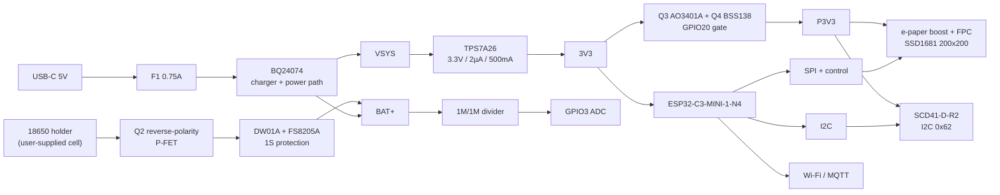

# CO2 Sensor Production Board — Execution Plan

## Context

The CO2 node is proven on development parts: ESP32-C3 SuperMini, SCD41 breakout, WeAct 1.54" e-paper module, and a battery-management board (`firmware/co2-node/README.md`). The repo contains firmware and documentation only — no schematic, PCB, BOM, enclosure, test fixture, or compliance file.

Goal: one custom PCB with **no development components**, ordered and assembled in the EU, plus enclosure, product firmware, production test, and EU compliance so units can be sold. First batch: **5 boards** — 3 home floors (existing floor firmware, existing panels) and 2 product units (1 gift, 1 compliance/sale; new panels). The 3 home units must keep the existing dashboard entity names (`sensor.top_floor_co2`, `_temperature`, `_humidity`, same for mid/bottom).

## Target design

### Block diagram



### Fixed decisions

| Area | Decision |
|---|---|
| MCU | `ESP32-C3-MINI-1-N4` (4 MB, PCB antenna). Firmware board id stays `esp32-c3-devkitm-1`; the module is electrically the same 4 MB C3. |
| CO2 sensor | `SCD41-D-R2`, bare LGA on the PCB. No breakout. |
| Display | Existing WeAct 1.54" 200×200 SSD1681 panels, plugged into an on-board 24-pin 0.5 mm FPC connector. The WeAct boost circuit is copied on-board; the WeAct PCB is not used. |
| Power | 18650 holder, user-supplied protected cell; USB-C 5 V charging; ship without a cell. |
| Assembly | AISLER "Amazing Assembly", 5 boards, 2-layer ENIG, self-supplied SCD41/ESP32 module if not in catalog. Eurocircuits is the fallback. |
| Enclosure | 3D-printed PETG, two-part screw case, front panel bezel, back battery cover. |
| Distribution | Sell within the EU; CE/RED, WEEE, packaging, GPSR, cybersecurity file. |
| Firmware | ESPHome 2026.10.1, MQTT discovery, deep sleep, per-unit identity and credentials. |

### Electrical contract (must remain identical to the working firmware)

| Signal | ESP32-C3-MINI-1 pin | Net | Firmware reference |
|---|---|---|---|
| SCD41 SDA | GPIO1 | `I2C_SDA` | `i2c.sda` |
| SCD41 SCL | GPIO21 | `I2C_SCL` | `i2c.scl` |
| EPD MOSI | GPIO6 | `EPD_SDA` | `spi.mosi_pin` |
| EPD SCK | GPIO4 | `EPD_SCL` | `spi.clk_pin` |
| EPD CS | GPIO7 | `EPD_CS` | `cs_pin` |
| EPD DC | GPIO5 | `EPD_DC` | `dc_pin` |
| EPD RST | GPIO0 | `EPD_RES` | `reset_pin` |
| EPD BUSY | GPIO10 | `EPD_BUSY` | `busy_pin` |
| Battery sense | GPIO3 (ADC1_CH3) | `VBAT_SENSE` | `adc.pin`, `multiply: 2.0` |
| Peripheral power | GPIO20 | `PWR_EN` | `switch.gpio`, HIGH = P3V3 on |
| USB D− / D+ | GPIO18 / GPIO19 | `USB_DM` / `USB_DP` | native USB CDC |
| BOOT | GPIO9 | `BOOT_N` | button to GND, 10k pull-up |
| Reset | EN | `RESET_N` | button to GND, 10k pull-up + 100nF |

GPIO2/GPIO8 are strapping pins; leave them with 10k pull-ups and no functions. GPIO20/21 are UART0 pins; the ROM may toggle them at boot, which is harmless. The logger stays on native USB (GPIO18/19), not UART0. Do not add a UART header.

The power gate is **active-high** and must have a 100k pull-down on GPIO20 so the rail is off during deep sleep. The battery divider is **VBAT/2** so the existing `multiply: 2.0` and SoC table remain valid.

### Key BOM

| Function | Part | Package | Qty | Notes |
|---|---|---|---|---|
| MCU | `ESP32-C3-MINI-1-N4` | module | 1 | 4 MB, integrated antenna, CE/RED reports from Espressif |
| CO2 | `SCD41-D-R2` | LGA 10.1×10.1×6.5 mm | 1 | MSL 3; VDD and VDDH tied at the sensor; DNC pads soldered to a floating pad |
| Display | `YRD0150BBS810F0-M7` 1.54" 200×200 SSD1681 | panel + 24-pin FPC | 1 | Reuse 3 existing panels for home units; buy 2 new for product units |
| FPC | 24-pin 0.5 mm, contact side per the WeAct `J1` footprint/panel drawing | SMD | 1 | Copy the WeAct `J1` land pattern exactly; confirm the contact side on a spare panel before layout |
| Boost | `L1 10µH`, `D2/D3 B5819W`, `Q1 AO3402`, caps per WeAct | 0603/SOD-323/SOT-23 | 1 set | Copy the WeAct `SchDoc.pdf` values and nets exactly |
| LDO | `TPS7A2633DRVR` | WSON-6 | 1 | 3.3 V, 500 mA, 2 µA quiescent; covers the ESP32 Wi-Fi TX peak plus sensor/display |
| Charger | `BQ24074RGTR` | VQFN-16 | 1 | Power path, 500 mA, TS/NTC, thermal regulation |
| Protection | `DW01A` + `FS8205A` | SOT-23-6 + TSSOP-8 | 1 | 1S over-discharge/over-current |
| Reverse polarity | `AO3401A` | SOT-23 | 1 | Battery input protection |
| Peripheral gate | `AO3401A` + `BSS138` | SOT-23 | 1 each | High-side P-FET + N-FET inverter |
| USB-C | 16-pin USB 2.0 receptacle | SMD | 1 | 5.1k CC1/CC2 to GND |
| ESD | `USBLC6-2SC6` | SOT-23-6 | 1 | D+/D−/VBUS |
| Battery holder | Keystone `1043` (77.1 mm THT) or equivalent | THT | 1 | Hand-solder; cell not supplied |
| NTC | 10k B3950 | 0603 | 1 | Adjacent to the cell, connected to charger TS |
| Buttons | 3×4 mm tactile | SMD | 2 | BOOT, RESET; pinholes in the case |
| LED | 0603 | SMD | 1 | Charge status from BQ24074 STAT |
| Test pads | 1.0 mm | — | 8 | `3V3`, `GND`, `BAT`, `P3V3`, `EN`, `GPIO9`, `SCL`, `PWR_EN` |
| Fiducials | 1.0 mm | — | 3 | Top side |

Passives: 0603, 1% resistors, X7R capacitors. The boost caps and inductor follow the WeAct schematic, including the 4.7 µF/50 V parts. The WeAct `ME6216A33` LDO is omitted: the panel and boost run from the board's 3V3 rail.

**SCD41 land-pattern rules (datasheet §2.3/§4.2):** pads are VDD, VDDH, GND, SDA, SCL, DNC. Tie VDD and VDDH together at the sensor with a 1 µF cap. Solder the DNC pads to a floating copper pad — do **not** connect them to GND. There is no SEL pin on the bare sensor. Use 10k I²C pull-ups to P3V3. The sensor needs a low-noise rail; add a ferrite bead + 10 µF from P3V3 to VDD.

### Mechanical envelope

- PCB: **95 × 45 mm**, 2-layer, 1.6 mm, ENIG, 1 oz. The 95 mm length clears the 77.1 mm 18650 holder and the 15 mm antenna keepout at the top.
- Front: e-paper panel at the top-left; outline ≈31.8 × 37.3 mm for this panel class, active 27 × 27 mm — take the final outline and FPC exit from the panel drawing, not from this estimate. FPC connector on the front at the panel's bottom edge; the panel is held by the case bezel 2 mm above the PCB so the FPC folds.
- Top-right: ESP32-C3-MINI-1 with the antenna overhanging the top edge; no copper, battery, or metal within 15 mm of the antenna; plastic case only.
- Back: 18650 holder, top edge at y = 15 mm, so the cell is at least 15 mm below the antenna. Access through the back cover.
- Bottom front: SCD41 at the board edge facing the vent grille; USB-C at the bottom edge; charger/LDO mid-board away from the sensor; boost at the top-left away from the antenna.
- Case: **101 × 51 × 26 mm**, PETG, front bezel + back cover, 4× M2.5 heat-set inserts, keyhole wall mount, 6× 2×10 mm vent slots at the bottom front, USB-C cutout, BOOT/RESET pinholes, charge-LED light pipe, 70 × 30 mm label recess on the back.
- Display window: open bezel (no glass), 1 mm overlap; e-paper is matte and reads better without a cover.

### Power budget (estimate; verify on the bench)

At 15-minute cadence: 3× SCD41 single-shot ≈ 18 s at ~15 mA, Wi-Fi ≈ 3 s at ~50 mA, e-paper refresh ≈ 3 s at ~10 mA → ~0.13 mAh per wake → ~12.5 mAh/day. The 3.3 V LDO browns out around 3.6 V under the Wi-Fi peak, so a 3000 mAh 18650 yields ~2200 mAh usable → ~5 months; target ≥3 months with margin. The SoC table below 3.6 V is advisory. Deep sleep budget: BQ24074 4.3 µA + TPS7A26 2 µA + ESP32-C3 ~5 µA + divider 2.1 µA ≈ 14 µA; acceptance ≤20 µA. Set the product default to 15 minutes, not 5.

## Approach

### Phase 1 — Freeze interfaces and scaffold the repo (blocks all)

1. Create `hardware/co2-node/` as a KiCad 9 project: `co2-node.kicad_pro`, `co2-node.kicad_sch`, `fp/`, `sym/`, `gerbers/`, `bom/`, `README.md`.
2. Copy the WeAct display reference into the project as `hardware/co2-node/reference/WeAct-EpaperModule-SchDoc.pdf` and transcribe it into a `display.kicad_sch` sheet. Do not redraw from memory.
3. Freeze the pin map table above. Any change is a rev B; the firmware and layout both depend on it.
4. Create `enclosure/` (FreeCAD/STEP/STL), `production/` (`build_unit.py`, `test_unit.py`, `label.svg`, `units.csv`), and `docs/compliance/`.
5. Record the electrical-equivalence rule in `hardware/co2-node/README.md`: the board must reproduce the dev wiring in `firmware/co2-node/README.md` with the same pin functions and polarities.

**Acceptance:** directory tree exists; the pin map is committed; the WeAct PDF is in the repo; firmware still compiles unchanged.

### Phase 2 — Schematic

1. `power.kicad_sch`: USB-C → 0.75 A polyfuse → USBLC6 → BQ24074 (500 mA ILIM/ISET) → VSYS; battery holder → 2 A polyfuse → Q2 reverse P-FET → DW01A/FS8205A → BAT+; VSYS → TPS7A26 → 3V3; 3V3 → Q3/Q4 gate → P3V3; BAT+ → 1 M/1 M divider → 100 nF → 1 k → GPIO3. Add the BQ24074 TS network with the 10k NTC, CHG/PGOOD LED, and 10 µF/1 µF/0.1 µF decoupling. Copy the DW01A/FS8205A application circuit from the datasheet; the charger and load connect to the protected side.
2. `mcu.kicad_sch`: ESP32-C3-MINI-1-N4, 10 µF + 1 µF + 0.1 µF, EN pull-up/cap, BOOT/RESET buttons, USB series 22 Ω and ESD, test pads, fiducials. Follow the Espressif land pattern and the antenna keepout.
3. `sensor.kicad_sch`: SCD41 with VDD/VDDH tied, DNC floating pad, 10k pull-ups, ferrite + 10 µF, 1 µF at the sensor, thermal relief and no copper pour under the body.
4. `display.kicad_sch`: 24-pin 0.5 mm FPC connector, WeAct boost (`L1 10 µH`, `D2/D3 B5819W`, `Q1 AO3402`, `C1`–`C13`, `R1`–`R9`, `SB1/SB2`), 100 Ω series on the panel signals, `E_BS` strapped for 4-line SPI. Feed the boost/panel from 3V3, not 5 V; omit `U1 ME6216A33`.
5. `connectors.kicad_sch`: 18650 holder, NTC, test pads, mounting holes, label reference.
6. Run ERC and fix every error. Review against this checklist:
   - No back-powering of the SCD41/panel when P3V3 is off; 100k gate pull-down; P-FET body diode orientation correct.
   - Charger TS, ILIM, ISET, and power-path pins per datasheet; no floating enable pins.
   - I²C pull-ups only to P3V3; no internal pull-ups in firmware.
   - DNC pads floating; VDD/VDDH tied at the sensor.
   - FPC contact side matches the panel; series resistors on all panel signals.
   - Antenna keepout clear on both layers; module ground pad stitched.
   - Test pads on accessible nets; no test pad on the antenna.
   - All connectors keyed or polarity-marked; battery reverse protection present.

**Acceptance:** ERC 0 errors; schematic review checklist signed; BOM exported with MPNs.

### Phase 3 — Layout

1. Board outline 95 × 45 mm, 2-layer, 1.6 mm, ENIG. Use AISLER's 2-layer rules: 0.2 mm min trace/space, 0.3 mm min drill, 0.6 mm min via pad.
2. Place per the floorplan: panel connector top-left, module top-right with the antenna overhanging, boost top-left, charger/LDO mid-board, SCD41 bottom front edge, USB-C bottom edge, battery holder on the back starting at y = 15 mm.
3. RF: continuous bottom GND; no copper/traces under the antenna on either layer; stitch the module ground; keep the boost switching loop tight and away from the antenna and sensor; keep the 18650 cell and its holder out of the antenna keepout.
4. Thermal: SCD41 at the edge, away from the charger/LDO/boost; vent slots in the case aligned to the sensor; no copper pour under the sensor body; keep the battery holder off the sensor. Place the test pads on the front side or the bottom edge clear of the 18650 holder so the pogo fixture can reach them with the holder installed.
5. Run DRC, then AISLER/Eurocircuits DFM checks. Export gerbers, drill, BOM, CPL/position, IPC-356 netlist, and STEP.
6. Import the STEP into `enclosure/` and verify: panel/FPC fold, battery holder clearance, USB-C cutout, button access, antenna clearance, case wall thickness, screw bosses.

**Acceptance:** DRC 0 errors, 0 unconnected; DFM passes; STEP fits the enclosure model with no interferences.

### Phase 4 — Rev A order and assembly

1. Verify stock and lead time for the SCD41, ESP32-C3-MINI-1-N4, BQ24074, TPS7A26, DW01A/FS8205A, and the FPC connector at Mouser/Digi-Key/Farnell/TME. Order the SCD41 and module in tape-and-reel, sealed with the MSL label.
2. Upload the KiCad project to AISLER; assign the BOM; mark the SCD41 and ESP32 module as self-supplied if they are not in the catalog. Confirm 2-layer, ENIG, both-side assembly, and the 18650 holder as THT (or hand-solder it).
3. Order 5 boards. Ship the self-supplied parts to AISLER in the original sealed bags; include the MSL 3 label. AISLER bakes per J-STD-033 if the seal is broken.
4. Buy 2 new panels for the product units; use the 3 existing panels for the home units. Do not harvest a panel from a module that will be kept as a bench reference.
5. Order the 18650 holders, NTCs, labels, and packaging. Do not order cells.

**Acceptance:** order confirmation with a dispatch date; all parts allocated to a unit; no dev board, breakout, or display module PCB in the BOM.

### Phase 5 — Bring-up and validation

1. Visual: no solder bridges, FPC connector aligned, SCD41 seated, battery holder polarity marked, fiducials present.
2. Rails (bench supply 3.7 V, current limit 200 mA): 3V3 = 3.30 ± 0.05 V; VSYS sane; P3V3 = 3.30 ± 0.05 V when GPIO20 is high, < 0.1 V when low.
3. Sleep current: insert a 1 k 0.1% shunt in the battery path or use a Nordic PPK2; measure for 10 minutes in deep sleep. Pass ≤ 20 µA (target ≤ 12 µA). If high, check the LDO, divider, charger leakage, and the P-FET gate.
4. Charging: USB-C 5 V; charge current 500 mA ± 10% at 3.7 V; termination 4.2 V ± 1%; NTC response; no component over 60 °C.
5. Sensor: `esphome logs` shows I²C 0x62; CO2 400–5000 ppm; exhale near the vent raises CO2; temperature/humidity sane.
6. Display: boot page, normal page, all pixels, no stuck lines; full refresh ~3 s; image persists through sleep.
7. Radio: join the 2.4 GHz AP; RSSI ≥ −75 dBm at the installation point; MQTT discovery and state topics appear; `mosquitto_sub` sees the expected entities.
8. Sleep/wake: 24 h at 5-minute cadence; no resets; wake duration < 30 s; battery voltage stable.
9. Rev B decision: fix any schematic/layout defect; budget one rev B order. Do not ship a reworked rev A if the defect affects RF, thermal, or safety.

**Acceptance:** all bench checks pass on at least 2 boards; sleep current and charge current recorded; one 24 h soak clean.

### Phase 6 — Firmware productization

1. Keep the pin map and `esp32-c3-devkitm-1` board id; keep `variant: esp32c3`, `framework: arduino`, 4 MB.
2. Set the product default cadence to 15 minutes: `deep_sleep.sleep_duration: 15min`, `sleep_interval` initial value 15. Keep 3 SCD41 samples and the window-3 filters; the README's 5-sample text is stale — update it.
3. Split the config so security is a package: `co2-node-core.yaml` (hardware/sensor/display/deep sleep), `co2-node-webui.yaml` (web server + auth), `co2-node-secure.yaml` (product-only NVS encryption + signed OTA), `co2-node-gift.yaml` (setup flow), `co2-node-home.yaml` (home Wi-Fi/MQTT), `top/mid/bottom.yaml` (home identities), `product.yaml` (per-unit product identity). Update the includes: `top/mid/bottom.yaml` = core + home + webui; `gift.yaml` = core + gift + webui; `product.yaml` = core + gift + webui + secure. Keep the home entity names unchanged.
4. Add `safe_mode:` and `ota:` (`platform: esphome`, `password: "${ota_password}"`) to the common config. Keep `web_server.ota: false`. Enable `web_server.auth` with `${web_user}`/`${web_password}`.
5. In `co2-node-secure.yaml`:
   ```yaml
   esp32:
     framework:
       advanced:
         nvs_encryption:
           key_id: 5
         signed_ota_verification:
           signing_key: ${ota_signing_key}
         enable_ota_downgrade_protection: true
   esphome:
     project:
       name: autohome.co2-node
       version: "1.0.0"
   ```
   Generate one RSA-3072 signing key; keep the private key outside the repo (e.g. `~/.config/autohome/ota_signing_key.pem`). `key_id: 5` avoids the Secure Boot key slots. The first boot burns the eFuse and wipes old preferences once — test this on one unit before flashing the batch.
6. Replace the universal setup identity in `co2-node-gift.yaml`:
   - `wifi.ap.ssid: "${ap_ssid}"` (default `co2-setup`; product `co2-setup-<last4>`).
   - `ap_password_sub` default remains for gifts; the product script generates a random 12-character password.
   - `page_setup` shows `JOIN ${ap_ssid}` and `PASS ${ap_password_sub}` on two lines with a 12 px font.
   - `reset_setup` resets `sleep_interval` to 15, not 5.
7. Product identity: `name_add_mac_suffix: false`; the build script sets `device_name: co2-sensor-<last4>`, `friendly_name: CO2 Sensor <last4>`, `ap_ssid`, `ap_password_sub`, `web_user: admin`, `web_password`, `ota_password`, and `discovery_uid_generator: mac`. The unique friendly name prevents HA entity collisions.
8. Vendor the Roboto/Material Icons fonts into `firmware/co2-node/fonts/` and point `font.file` at them; no network at build time.
9. Create `production/build_unit.py`: read the MAC (probe firmware or `esptool.py read_mac`), render `product.yaml` from the template, `esphome compile`, copy factory/OTA binaries, flash over USB, generate `label.svg` with a Wi-Fi join QR (`WIFI:T:WPA;S:<ap_ssid>;P:<ap_password>;;`) and a setup QR (`http://192.168.4.1`), append the unit row to `units.csv`.
10. Add `firmware/co2-node/test.yaml`: DEBUG logging, the home test Wi-Fi/MQTT, a checkerboard display page, and a long run duration. Use it for bring-up and production test; flash the release image afterward.

**Acceptance:** `esphome config product.yaml` validates; a per-unit build boots, shows the unique AP, provisions, publishes to a test broker, and survives a power cycle; the release image has no DEBUG logging.

### Phase 7 — Enclosure

1. Model in FreeCAD: front bezel (panel opening, 1 mm overlap), PCB standoffs, back cover (battery bulge, label recess, keyhole), vent grille, USB-C cutout, button pinholes, LED light pipe.
2. Print PETG, 0.2 mm layers, 4 perimeters, 25% gyroid. Heat-set M2.5 inserts; 4× M2.5×8 screws.
3. Fit: panel flush and dust-free; FPC not pinched; battery inserts/removes without tools; USB-C cable seats; buttons reachable with a pin; label flat.
4. Thermal/CO2: with the case closed, compare the SCD41 temperature to a reference after 30 minutes and set the firmware temperature offset per unit. Confirm the vent response with an exhale test; the CO2 rise must appear within 2–3 minutes (the SCD41 τ63% is 60 s).
5. Drop/transport: 1 m drop onto a hard floor in the retail box; no cracks, no rattles, display intact.

**Acceptance:** 5 cases fit their boards; no interference; temperature offset recorded; CO2 response verified.

### Phase 8 — EU compliance (sell-ready gate)

1. Start the technical file in `docs/compliance/`: product description, intended use, photos, schematics, layout, BOM, label, manual, risk assessment, security assessment.
2. Standards baseline: RED 2014/53/EU (3.1(a)(b), 3.2, 3.3(d)(e)(f)); EN 62368-1 (safety); EN 55032/EN 55035 (EMC); EN 300 328 (2.4 GHz); EN 301 489-1/-17; EN 62479 or EN 50663 (RF exposure); EN 18031-1 (cybersecurity); EN IEC 63000 (RoHS); WEEE 2012/19/EU; Battery Regulation (EU) 2023/1542; GPSR (EU) 2023/988; Packaging Directive 94/62/EC.
3. Request the ESP32-C3-MINI-1 CE/RED test reports from Espressif or the distributor. The host board still needs EMC and RF assessment; the module report reduces the radio work.
4. Book an EMC pre-scan with a German lab (2 quotes). Test the final enclosure and final firmware at 8.5 dBm. Require ≥6 dB margin; fix with ferrite beads, ground stitching, boost snubber, or cable routing, then re-scan.
5. Cyber pre-assessment: unique AP password, `web_server` auth, `nvs_encryption`, signed OTA, downgrade protection, no default MQTT credentials, documented update policy and vulnerability contact. If the assessor flags plain MQTT or HTTP, implement one of:
   - MQTT over TLS 8883 with `certificate_authority` (compile-time CA; requires a publicly trusted broker certificate), or
   - ESPHome native API with encryption instead of MQTT, or
   - remove the web server from the product build and expose calibration as MQTT numbers.
   Re-run the pre-assessment before the formal test.
6. Register WEEE (stiftung ear) and packaging (LUCID/VerpackG) before the first sale. Use a compliance service if the volumes are small. The seller is the manufacturer/importer under RED and GPSR; the DoC and label carry the seller's legal name and address.
7. Write the German/English manual: safety, 18650 cell specification (protected 3.6/3.7 V Li-ion, 65 mm, ≥2500 mAh), charging, setup, HA MQTT, calibration, display, firmware updates, disposal, support. Add the simplified DoC and the full DoC URL.
8. Design the label: CE, WEEE, model `AH-CO2-1`, serial, MAC, AP SSID/password, input 5 V ⎓ 0.5 A, "Assembled in the EU", manufacturer name/address. Do not put a metallic label over the antenna.

**Acceptance:** formal RED/EMC report pass; cybersecurity assessment pass; DoC signed; WEEE/packaging registrations active; manual and label approved.

**Gate C (business):** at 5 units the compliance cost is roughly €1,200–2,600 per unit. Approve the budget for a 50–100 unit batch (≈€120–260/unit amortized) or stop before the formal test and keep the units personal/gift. Do not sell without the DoC.

### Phase 9 — Production test and build

1. Build the fixture: 3D-printed cradle, 8 pogo pins (`3V3`, `GND`, `BAT`, `P3V3`, `EN`, `GPIO9`, `SCL`, `PWR_EN`), USB-C cable, 3.7 V battery emulator with a 1 k shunt and a DMM (or PPK2).
2. `production/test_unit.py` per unit:
   - Flash the test image; capture boot, Wi-Fi, MQTT, I²C 0x62, CO2/temp/RH, battery voltage, wake duration, display page.
   - Assert CO2 400–5000 ppm, temp −10…50 °C, RH 0–100%, battery 3.0–4.2 V, wake < 30 s, no reset.
   - Measure sleep current ≤ 20 µA; charge current 500 mA ± 10%; battery ADC within ±50 mV of the DMM.
   - Write the results to `production/units.csv`.
3. 5-day burn-in: power all units in a well-ventilated room, 15-minute cadence, log MQTT. Check no resets; the SCD41 ASC restores accuracy after assembly. Do not judge CO2 accuracy before this burn-in.
4. Calibrate each unit: set the temperature offset from the reference thermometer; set altitude 500 m; leave CO2 offset at 0. Verify the three home units agree within ±(50 ppm + 5%) at 400/1000 ppm.
5. Flash the release image (signed, DEBUG off), apply the label, and assemble the case. Record the serial, MAC, AP password, OTA password, firmware version, and test results.

**Acceptance:** all 5 units pass; the 3 home units publish to HA; the 2 product units pass the full test; records complete.

### Phase 10 — Ship

1. Package: 120 × 70 × 40 mm box, foam insert, 0.5 m USB-C cable, quick-start card, no 18650 cell. Add the battery warning and the "no battery included" label.
2. The quick-start card: insert a protected 18650; join the AP with the QR; open `192.168.4.1`; enter Wi-Fi and MQTT; press Finish; add the device in HA; calibrate. Include the support email and the manual URL.
3. Ship with a tracked, insured parcel service. No dangerous-goods declaration because no cell is included.
4. Support: a web page with the manual, firmware, HA MQTT instructions, troubleshooting, and the vulnerability contact. Keep a 2-year legal guarantee and a 5-year security-update policy.

**Acceptance:** one sale-ready unit ships with the DoC, manual, label, and test record; the 3 home units are installed and publishing.

### Schedule and gates

| Week | Work | Gate |
|---|---|---|
| 1–3 | Phase 1–3: scaffold, schematic, layout, DFM, STEP/enclosure fit | Schematic/layout review pass |
| 3 | Order rev A boards and parts; order 2 panels | All parts allocated; no dev components |
| 4–6 | Phase 4–5: assembly, bring-up, 24 h soak | Rev A pass or rev B decision |
| 4–7 | Phase 6–7 in parallel: firmware productization, enclosure | Firmware/enclosure freeze |
| 7–9 | Phase 8: EMC pre-scan, cyber pre-assessment | ≥6 dB margin; cyber baseline accepted |
| 9–13 | Phase 8: formal RED/EMC test, WEEE/packaging, DoC | Gate C budget approval; DoC signed |
| 12–14 | Phase 9–10: production test, 5-day burn-in, build, ship | 5 units pass; first sale unit ships |

Book the EMC lab at week 6; the lead time is 4–6 weeks. The critical path is the SCD41/panel lead time and the compliance lab, not the PCB assembly.

## Critical files & anchors

1. `firmware/co2-node/co2-node-common.yaml` — the electrical contract: `i2c` (GPIO1/21), `spi` (GPIO4/6), `display` (GPIO7/5/0/10), `adc` (GPIO3), `switch` (GPIO20), `scd4x`, `deep_sleep`. Any pin or polarity change breaks the board.
2. `firmware/co2-node/co2-node-gift.yaml` — the provisioning flow: `ap_password_sub`, `wifi.ap.ssid`, `page_setup`, `finish_setup`, `reset_setup`, runtime MQTT. The universal AP identity is here.
3. `firmware/co2-node/README.md` — the wiring and power-budget record; the 5-sample text conflicts with the 3-sample code; update both.
4. `hardware/co2-node/` (new) — KiCad project; the WeAct `SchDoc.pdf` display block and the SCD41 datasheet land pattern are the two copy-critical references.
5. `production/` (new) — `build_unit.py`, `test_unit.py`, `label.svg`, `units.csv`; per-unit identity and traceability.

## Verification

### Bench acceptance matrix

| Area | Check | Method | Pass |
|---|---|---|---|
| Power | 3V3 / P3V3 | DMM | 3.30 ± 0.05 V; P3V3 < 0.1 V in sleep |
| Power | Sleep current | 1 k shunt + DMM or PPK2, 10 min | ≤ 20 µA |
| Power | Charge | USB-C 5 V, DMM | 500 mA ± 10%; 4.2 V ± 1% |
| Sensor | I²C | `esphome logs` | 0x62 detected |
| Sensor | CO2 | fresh air + exhale | 400–5000 ppm; responds within 2–3 min |
| Sensor | Temp/RH | reference thermometer | ±0.8 °C / ±5% after offset |
| Display | Pixels | checkerboard test page | all pixels, no stuck lines |
| Radio | Wi-Fi | RSSI at installation | ≥ −75 dBm |
| Radio | MQTT | `mosquitto_sub -t '#' -v` | discovery + state topics |
| Sleep | 24 h cycle | logs | no reset; wake < 30 s |
| Battery | Life | 2-week voltage log | extrapolated ≥ 3 months |
| Mechanical | Case | fit check | panel flush, USB/buttons/vents clear |
| Compliance | EMC pre-scan | lab | ≥ 6 dB margin |
| Compliance | RED/EMC | lab | pass; DoC signed |
| Production | 5 units | `production/test_unit.py` | all pass; `units.csv` complete |

### End-to-end proof

1. `cd hardware/co2-node && kicad-cli sch erc co2-node.kicad_sch && kicad-cli pcb drc co2-node.kicad_pcb` → 0 errors.
2. `cd firmware/co2-node && esphome config product.yaml && esphome compile product.yaml` → valid, builds a signed image.
3. Flash a unit; join `co2-setup-XXXX` with the label password; provision to the test broker; `mosquitto_sub -h <broker> -t '#' -v` shows discovery and `co2`/`temperature`/`humidity`/`battery` states.
4. Run `python3 production/test_unit.py --serial <serial> --port /dev/ttyACM0 --broker <broker>` → pass; sleep current and charge current recorded.
5. Install the 3 home units; HA shows `sensor.top_floor_co2`, `sensor.mid_floor_co2`, `sensor.bottom_floor_co2` (and `_temperature`/`_humidity`); the dashboard renders; the CO2 > 1000 ppm automation opens the Velux window.
6. Build the 2 product units; run the 5-day burn-in; pack one with no cell; verify the box label and DoC; ship.

## Assumptions & contingencies

- **Panel supply:** the board is designed around `YRD0150BBS810F0-M7` / SSD1681 and the WeAct FPC pinout. If a replacement panel uses a different controller or FPC, re-qualify the init and the connector before layout; do not substitute silently.
- **Assembly vendor:** AISLER is primary. If it rejects the self-supplied SCD41/ESP32 module or the 18650 holder, use Eurocircuits (customer-supplied parts, 1–50 pcs) without changing the design files.
- **Battery holder:** the 77.1 mm Keystone 1043 keeps the antenna clearance. If it is unavailable, use the 86 mm Keystone 1042 (SMD) and extend the board/case by 10 mm; do not shrink the antenna keepout.
- **Compliance budget:** if Gate C is not approved, stop before the formal test; the hardware and firmware are still valid for personal/gift use, but no CE mark or sale.
- **RED cybersecurity assessment:** if plain MQTT or the HTTP web UI is rejected, use the `co2-node-core`/`co2-node-webui` split to ship a no-web build and/or add MQTT TLS or native API encryption; re-test before the formal EMC test.
- **ESPHome security features:** `nvs_encryption` (HMAC key block 5) and `signed_ota_verification` are supported in ESPHome 2026.10.1. Validate on one unit first. If the Arduino framework rejects the NVS encryption sdkconfig, switch that package to `framework: type: esp-idf`, recompile, and re-run the bring-up.
- **Enclosure production:** if no 3D printer is available, order PETG prints from a local service using the STEP; the fit and thermal checks still apply.
- **Rev A defects:** budget one rev B order (≈€250–400 assembly setup + parts). Do not ship a rev A with an RF, thermal, or safety defect.
- **SCD41 handling:** MSL 3; keep the tape sealed until assembly; bake per J-STD-033 if opened. Accuracy is reduced immediately after reflow; the 5-day burn-in or FRC restores it.
- **Batch economics:** the first 5 units are a beta batch. Compliance is only affordable when amortized over ≥50 units; set the sale price accordingly or treat the first batch as a prototype.
